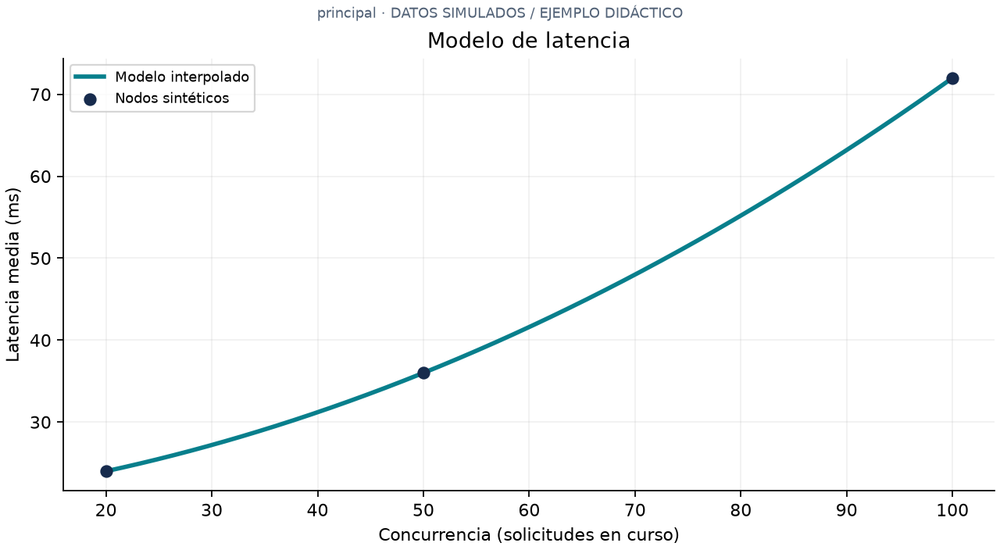
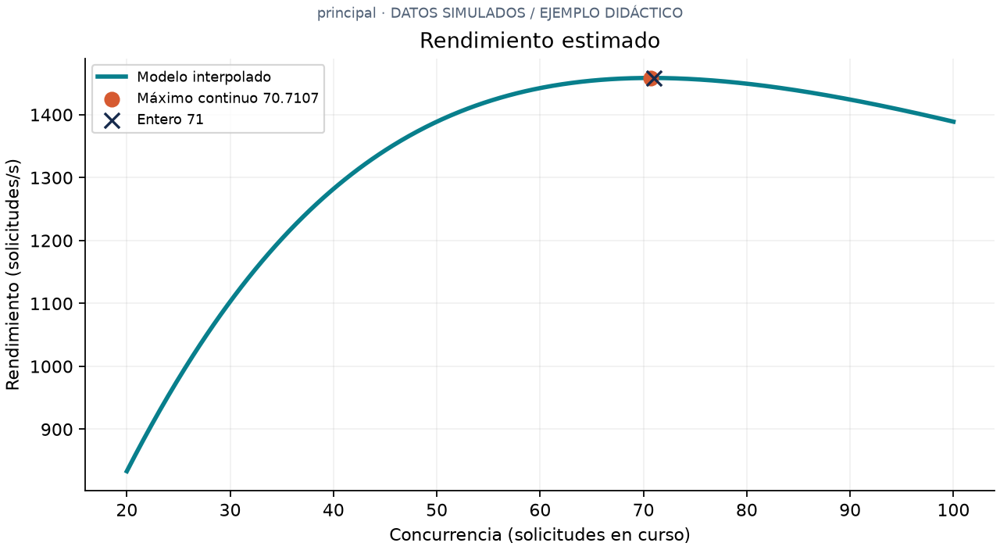
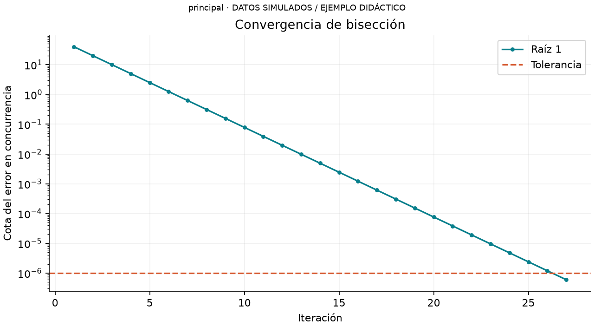
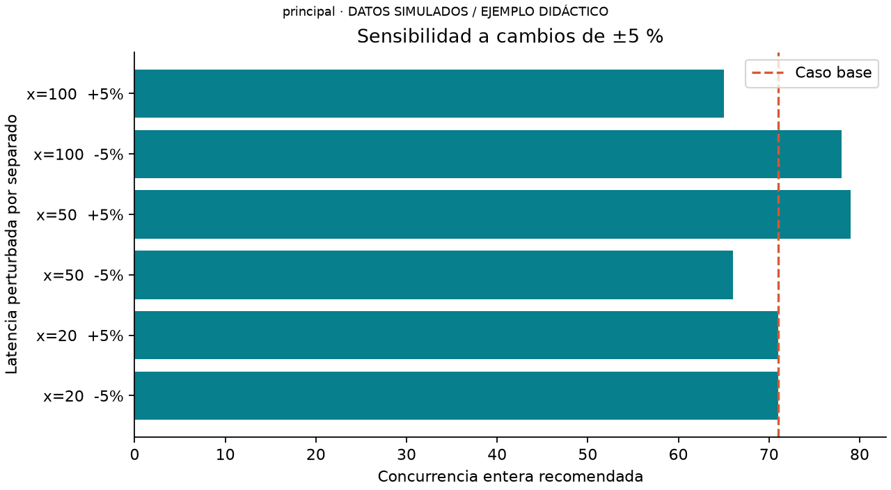
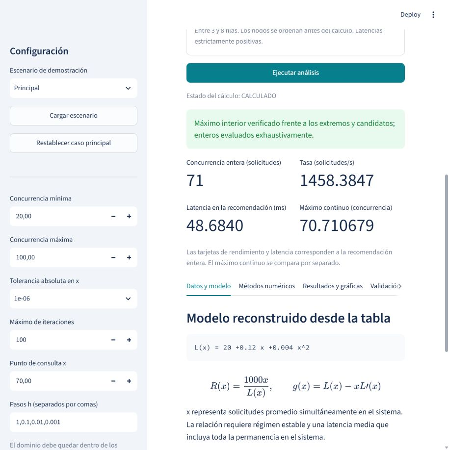
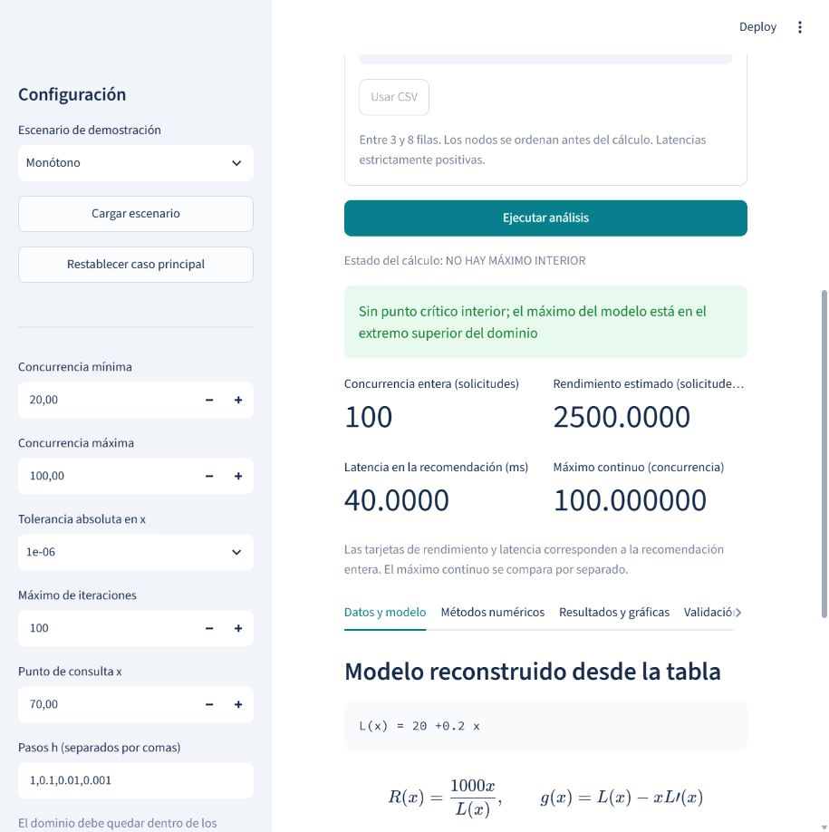

# Optimización del rendimiento de un servidor

Interpolación de Newton y búsqueda del máximo mediante bisección

Proyecto final de Métodos Numéricos · Ingeniería de Sistemas · 3 de noviembre de 2026

Integrantes: __________________________________________________________

DATOS SIMULADOS / EJEMPLO DIDÁCTICO

## Resumen

Se desarrolló un simulador local en Python para estudiar qué concurrencia maximiza una tasa estimada de solicitudes completadas. La interpolación de Newton reconstruye la latencia a partir de tres nodos sintéticos y la bisección resuelve la condición de derivada nula. En el escenario principal, el máximo continuo se aproxima en x=70.710679; la recomendación discreta es 71 solicitudes concurrentes, con latencia 48.684000 ms y rendimiento 1458.384685 solicitudes/s. Un segundo escenario lineal alcanza su máximo en el límite superior, con 100 solicitudes concurrentes. La implementación compara extremos, candidatos interiores y todos los enteros admisibles. Los resultados ilustran un procedimiento numérico y no certifican la capacidad de un servidor real.

## Introducción

La concurrencia expresa cuántas solicitudes permanecen simultáneamente en un sistema. Aumentarla puede aprovechar recursos disponibles, pero también elevar la latencia por esperas y contención. Por ello, una decisión de planificación debe considerar conjuntamente la cantidad de solicitudes en curso y su tiempo de respuesta. La pregunta de este proyecto es qué concurrencia maximiza el rendimiento estimado dentro de un dominio observado.

Se estudia un modelo matemático reproducible, sin generar tráfico HTTP, instalar un servidor de producción ni medir hardware. La aplicación permite editar datos, inspeccionar los procedimientos y exportar las evidencias del cálculo.

## Justificación

Newton permite obtener una función continua a partir de datos discretos considerados exactos. Su representación mediante diferencias divididas facilita la construcción progresiva del polinomio y su evaluación (Chapra y Canale, 2015, §18.1; Ascher y Greif, 2011, §10.4; Kong et al., 2021, §17.5). La bisección se elige por su reducción controlada del intervalo cuando una función continua cambia de signo (Chapra y Canale, 2015, pp. 99–100). Ambos métodos se conectan: la interpolación define el modelo cuya condición de optimalidad se resuelve después.

## Modelo matemático

### Variables e hipótesis

x es el número promedio de solicitudes en el sistema; L(x) es su tiempo medio total de permanencia, en milisegundos; R(x) es una tasa estimada en solicitudes/s. Bajo régimen estable, la relación de Little conecta el número promedio en el sistema con la tasa y el tiempo medio (Whitt, 2015, §1). Al convertir milisegundos a segundos se obtiene x = R(x)L(x)/1000 y, por tanto, R(x)=1000x/L(x). Se supone una definición consistente de las solicitudes y de su permanencia total.

### Procedencia de los datos

Los nodos del caso principal fueron diseñados como ejemplo didáctico usando L_sint(x)=20+0.12x+0.004x². Los 20 ms son una base hipotética; el término lineal y el cuadrático representan incrementos ilustrativos de latencia. Ningún coeficiente procede de mediciones, registros ni bibliografía. El motor recibe solamente la tabla y reconstruye el polinomio: recuperar el generador verifica el algoritmo, pero no demuestra capacidad predictiva sobre datos reales.

| Concurrencia | Latencia principal (ms) | Latencia monótona (ms) |
| --- | --- | --- |
| 20 | 24 | 24 |
| 50 | 36 | 30 |
| 100 | 72 | 40 |

Tabla 1. DATOS SIMULADOS / EJEMPLO DIDÁCTICO. El dominio de ambos escenarios es [20,100]. El segundo conjunto procede del generador sintético L_sint(x)=20+0.2x.

### Interpolación y condición de optimalidad

Para nodos distintos, f[x_i]=y_i y f[x_i,…,x_j]=(f[x_(i+1),…,x_j]−f[x_i,…,x_(j−1)])/(x_j−x_i). El polinomio suma cada diferencia dividida multiplicada por los factores de Newton correspondientes (Kong et al., 2021, pp. 305–306).

Los coeficientes calculados son 24, 0.4 y 0.004. Por tanto, P₂(x)=24+0.4(x−20)+0.004(x−20)(x−50), equivalente a L(x) = 20 +0.12 x +0.004 x^2. En el punto de consulta x=70 se obtiene L=48.000000 ms y R=1458.333333 solicitudes/s.

Por la regla del cociente, R′(x)=1000[L(x)−xL′(x)]/L(x)². Si L(x)>0, el signo de la derivada coincide con g(x)=L(x)−xL′(x). Para el caso principal, g(x)=20−0.004x². Su raíz positiva de referencia es √5000, y el signo cambia de positivo a negativo. Para el caso monótono g(x)=20, de modo que no existe punto crítico interior.

### Cálculo guiado de la latencia

Queremos estimar cuánto tarda una solicitud cuando hay 70 en curso. La tabla da datos para 20, 50 y 100. Como 70 está entre esos valores, podemos interpolar. Leer (50,36) significa que en ese escenario había un promedio de 50 solicitudes en curso y que cada una permanecía en el sistema una media de 36 ms.

| Símbolo | Qué representa | Valor en este ejemplo |
| --- | --- | --- |
| xᵢ | Concurrencia del nodo de índice i | x₀ = 20, x₁ = 50, x₂ = 100 |
| yᵢ = L(xᵢ) | Latencia del nodo i, en ms | y₀ = 24, y₁ = 36, y₂ = 72 |
| x | Concurrencia que se quiere evaluar | 70 solicitudes en curso |
| P₂(x) | Latencia que estima el polinomio de grado ≤ 2 | P₂(70) = 48 ms |

El subíndice i enumera las filas desde cero. El número 2 de P₂ indica el grado máximo del polinomio que se puede construir con tres nodos distintos. Para comprobar de dónde venía la primera fila sintética, se sustituye x=20 en el generador: 20 + 0.12 × 20 + 0.004 × 20² = 20 + 2.4 + 1.6 = 24 ms. Ese cálculo crea la entrada. Los pasos siguientes reconstruyen la curva usando los tres pares de la tabla.

### Paso 1. Calcular las pendientes entre nodos

Entre las dos primeras filas, la latencia aumenta 36−24 = 12 ms cuando la concurrencia aumenta 50−20 = 30. Su pendiente media es f[20,50] = 12/30 = 0.4 ms por solicitud adicional en curso. Entre las dos últimas filas, f[50,100] = (72−36)/(100−50) = 36/50 = 0.72. El segundo tramo es más empinado, así que una sola recta no reproduce las tres latencias.

### Paso 2. Incorporar el cambio de pendiente

La diferencia dividida de segundo orden usa los extremos de los tres nodos: f[20,50,100] = (0.72−0.4)/(100−20) = 0.32/80 = 0.004. Sus unidades son ms por unidad de concurrencia al cuadrado. El primer coeficiente de Newton es la latencia inicial, 24 ms. El segundo es la primera pendiente, 0.4. El tercero es 0.004, que corrige la curvatura.

### Paso 3. Estimar la latencia para 70 solicitudes

Newton da P₂(x) = 24 + 0.4(x−20) + 0.004(x−20)(x−50). El primer término arranca en 24 ms. El segundo suma la tendencia lineal. El tercero se anula en los dos primeros nodos y permite ajustar el tercero. Con x=70, P₂(70) = 24 + 0.4 × 50 + 0.004 × 50 × 20 = 24 + 20 + 4 = 48 ms. Se puede comprobar en el último nodo: P₂(100) = 24 + 32 + 16 = 72 ms.

### Cálculo guiado del rendimiento y del máximo

1. Convertir tiempo en tasa. Con x=70 y L(70)=48 ms, el tiempo medio en segundos es W=48/1000=0.048 s. En régimen estable, x=R×W. Al despejar se obtiene R=70/0.048=1458.333333 solicitudes/s. La división usa el número medio en curso y el tiempo medio que ocupa cada solicitud. El 1000 viene de las unidades: un segundo contiene 1000 ms.

2. Preguntar si conviene aumentar la concurrencia. El rendimiento depende de x tanto en el numerador como en la latencia del denominador. Expandir el polinomio da L(x)=20+0.12x+0.004x². Su derivada, L′(x)=0.12+0.008x, estima cuánto aumenta la latencia por una unidad adicional de concurrencia. En x=70 vale 0.12+0.008×70=0.68 ms por unidad. La prima significa derivada respecto a x.

3. Determinar el sentido del cambio. La regla del cociente da R′(x)=1000g(x)/L(x)². En este caso g(x)=(20+0.12x+0.004x²)−x(0.12+0.008x)=20−0.004x², en ms. En 70, g(70)=48−70×0.68=0.4 ms. Por eso R′(70)=1000×0.4/48²=0.173611 solicitudes/s por unidad de concurrencia. La pendiente positiva indica que la curva aún sube ligeramente. En 71, g(71)=20−0.004×5041=−0.164 ms, así que ya baja.

4. Ubicar el máximo continuo. El cambio de positivo a negativo encierra un máximo entre 70 y 71. En este ejemplo podemos comprobar el método con álgebra: 20−0.004x²=0 implica x²=20/0.004=5000. La raíz del dominio es √5000≈70.710678. El símbolo x* designa esa ubicación del máximo. La bisección calcula su aproximación usando solo el modelo reconstruido y los signos. El apartado «Cómo leer una iteración de bisección» explica las columnas de la aplicación.

5. Convertir la solución en una decisión entera. Probar 70 da 1458.333333 solicitudes/s. Para 71, L(71)=20+0.12×71+0.004×71²=20+8.52+20.164=48.684 ms. Por tanto R(71)=71000/48.684=1458.384685 solicitudes/s. La ganancia frente a 70 es 0.051352 solicitudes/s. La aplicación compara los 81 enteros de 20 a 100, incluidos los extremos, y confirma que 71 es el mejor. La pequeña diferencia importa al interpretar la precisión práctica de la recomendación.

6. Repetir el razonamiento con el escenario lineal. Las pendientes son (30−24)/30=0.2 y (40−30)/50=0.2. Su diferencia es cero. Newton produce L(x)=24+0.2(x−20)=20+0.2x. Como L′(x)=0.2, g(x)=20+0.2x−0.2x=20 ms para todo x. La tasa crece en todo el intervalo. El mejor extremo es 100, con L(100)=20+0.2×100=40 ms y R(100)=1000×100/40=2500 solicitudes/s. El número de iteraciones de bisección es cero.

## Implementación numérica

El código separa el núcleo numérico de Streamlit. interpolacion.py construye la tabla; modelo.py calcula L, L′, R y g; biseccion.py implementa la búsqueda; analisis.py compara candidatos y enteros; exportacion.py produce CSV, JSON, PNG y ZIP. app.py presenta entradas, resultados y mensajes. src.main proporciona una ejecución sin interacción.

### Procedimiento reproducible

1. Leer y ordenar los nodos. Rechazar duplicados, latencias no positivas, datos no finitos o concurrencias no enteras. 2. Construir Newton mediante diferencias divididas. 3. Derivar el polinomio calculado y comprobar la positividad de L en extremos y puntos estacionarios. 4. Aislar candidatos de g usando puntos críticos de g para subdividir el dominio. 5. Aplicar bisección solamente en intervalos con cambio de signo. 6. Comparar candidatos y fronteras. 7. Evaluar todos los enteros y exportar la recomendación junto con los parámetros.

La variable interna t=(x−centro)/escala normaliza los nodos para reducir cancelación. La forma en potencias de x se conserva para mostrarla. Se admiten entre 3 y 8 observaciones y hasta 100001 enteros en el dominio. Se bloquea la extrapolación. Con grados superiores se aíslan recursivamente raíces de derivadas, incluyendo posibles raíces tangentes; se emplean tolerancias relativas de punto flotante. Esta comprobación excede una malla finita, pero no constituye una certificación por aritmética de intervalos; casos muy mal condicionados o raíces casi coincidentes requieren otro análisis.

### Bisección y criterio de parada

Se verifica continuidad por la naturaleza polinómica y signos opuestos en los extremos. En cada paso se calcula m=a+(b−a)/2, se conserva el subintervalo que encierra la raíz y se registra la cota (b−a)/2 antes de actualizar. Se detiene cuando esa cota no supera la tolerancia absoluta en x, o cuando g(m)=0 exactamente. El agotamiento del máximo de iteraciones produce un error. Este control evita confundir un residuo pequeño con un error pequeño en la variable (Ascher y Greif, 2011, pp. 43–44; Kong et al., 2021, p. 327).

La ejecución principal usa tolerancia 1e-06 y límite 100. La búsqueda automática inicia en [20,100], donde g cambia de signo; por ello su traza difiere de la demostración manual que inicia en [50,100]. Los tests comprueban también ese segundo intervalo. Ambos conducen al mismo máximo dentro de la tolerancia.

### Validación auxiliar de la derivada

La expansión de Taylor de R(x+h) y R(x−h), al restarse y dividirse por 2h, produce D_hR(x)=[R(x+h)−R(x−h)]/(2h)=R′(x)+O(h²) si existen derivadas suficientes. Se contrasta esta aproximación con la derivada analítica del modelo. Reducir h disminuye inicialmente la truncación, pero puede amplificar el redondeo. Esta validación no es el método principal de optimización.

### Cómo leer una iteración de bisección

a y b son los límites izquierdo y derecho del tramo que todavía puede contener la raíz. m=(a+b)/2 es su punto medio. En el dominio inicial, g(20)=18.4 ms y g(100)=−20 ms. Como los signos son opuestos y g es continua, el tramo encierra una raíz. Cada fila de la tabla usa el mismo cálculo, con límites nuevos.

| Paso | a | b | m | g(m) en ms | Cota en x |
| --- | --- | --- | --- | --- | --- |
| 1 | 20 | 100 | 60 | 5.6 | 40 |
| 2 | 60 | 100 | 80 | -5.6 | 20 |
| 3 | 60 | 80 | 70 | 0.4 | 10 |

Primera fila: m=(20+100)/2=60 y g(60)=20−0.004×60²=5.6. Como g(60)>0 y g(100)<0, se conserva [60,100]. En la segunda fila, m=80 y g(80)=−5.6, así que se conserva [60,80]. En la tercera, m=70 y g(70)=0.4, por lo que se pasa a [70,80]. La cota anterior a la actualización es (b−a)/2. En la primera fila esto vale (100−20)/2=40 unidades de concurrencia. Este es el mayor error posible al tomar el punto medio como estimación de la raíz en ese paso.

En la fila 27, a=70.710678101, b=70.710679293 y m=70.710678697. La cota es 5.960e-07, inferior a la tolerancia 1e−6 (una millonésima de unidad de concurrencia). La distancia efectiva respecto a √5000 es 5.780e-07. La cota siempre disminuye al reducir el intervalo. El error efectivo de un punto medio aislado puede ser menor por casualidad aun usando una tolerancia más gruesa, como se ve en la tabla de convergencia.

### Cómo comprobar la derivada y leer el error

El paso h es la distancia que miramos a cada lado del punto de consulta. Para x=70 y h=1 se toman 69 y 71. Las tasas calculadas son R(69)=1458.03397853 y R(71)=1458.38468491 solicitudes/s. Su pendiente media es [R(71)−R(69)]/(2×1)=0.17535319. Frente a R′(70)=0.17361111, el error absoluto es |0.17535319−0.17361111|≈0.00174208. Las barras verticales indican distancia sin signo. Estos resultados tienen unidades de solicitudes/s por unidad de concurrencia. La notación O(h²) indica que, al dividir h entre diez, se espera que la parte del error debida a la aproximación disminuya unas cien veces, mientras el redondeo sea pequeño.

La coordenada interna t=(x−centro)/escala sirve para evaluar el mismo polinomio con números más próximos a cero. Aquí centro=(20+100)/2=60, escala=(100−20)/2=40 y para x=70 resulta t=(70−60)/40=0.25. Al presentar los resultados, la aplicación vuelve a la unidad original de concurrencia.

## Resultados y discusión

### Máximo continuo y recomendación entera

| Escenario | Máximo x | Entero | L(entero) ms | R(entero) solicitudes/s |
| --- | --- | --- | --- | --- |
| principal | 70.710679 | 71 | 48.684000 | 1458.384685 |
| monotono | 100.000000 | 100 | 40.000000 | 2500.000000 |

Tabla 2. DATOS SIMULADOS / EJEMPLO DIDÁCTICO. Valores calculados y redondeados a seis decimales. Máximo x incluye fronteras; en el escenario monótono el campo optimo_continuo del JSON es nulo porque no hay máximo interior.

En el principal, R(x*)=1458.394715 solicitudes/s y L(x*)=48.485282 ms. Los extremos producen 833.333333 y 1388.888889 solicitudes/s. Se compararon 81 enteros; entre los vecinos, R(70)=1458.333333 y R(71)=1458.384685 solicitudes/s. Se recomienda 71 por su mayor tasa dentro del modelo, aunque la diferencia local es pequeña.

Figura 1. Latencia reconstruida y nodos sintéticos del escenario principal.

### Forma de la función objetivo

Figura 2. El candidato interior supera los extremos; la recomendación entera se compara separadamente.

La tasa crece inicialmente porque aumenta la concurrencia más rápido que la latencia relativa. Después del máximo, la penalización de latencia domina. Esta interpretación corresponde a las funciones construidas, no a una medición de saturación real.

| Tolerancia | Iteraciones | Máximo x | Error contra √5000 |
| --- | --- | --- | --- |
| 0.01 | 13 | 70.712891 | 2.213e-03 |
| 0.0001 | 20 | 70.710678 | 1.807e-08 |
| 1e-06 | 27 | 70.710679 | 5.780e-07 |

Tabla 3. Convergencia del caso principal con intervalo automático [20,100]. En la ejecución a 1e-06, la cota final es 5.960e-07 y el error frente a la raíz analítica es 5.780e-07. El control en x aporta una interpretación directa de la precisión.

### Convergencia y diferencias centrales

Figura 3. Reducción del semiancho en cada paso de bisección.

| h | Derivada analítica | Diferencia central | Error absoluto |
| --- | --- | --- | --- |
| 1 | 0.17361111 | 0.17535319 | 1.742e-03 |
| 0.1 | 0.17361111 | 0.17362853 | 1.742e-05 |
| 0.01 | 0.17361111 | 0.17361129 | 1.742e-07 |
| 0.001 | 0.17361111 | 0.17361111 | 1.589e-09 |

Tabla 4. Derivadas de R en x=70; unidades (solicitudes/s) por unidad de concurrencia. La reducción inicial del error concuerda con la fórmula central. La exactitud de interpolación en los nodos comprueba la implementación, no el error respecto de una población real desconocida.

### Sensibilidad a las latencias de entrada

Figura 4. Cada latencia se perturba por separado en ±5 % y se reconstruye el modelo.

| Nodo alterado | Cambio | Óptimo x | Entero | R(entero) solicitudes/s |
| --- | --- | --- | --- | --- |
| 20 | -5% | 70.7107 | 71 | 1449.3197 |
| 20 | +5% | 70.7107 | 71 | 1467.5637 |
| 50 | -5% | 65.6330 | 66 | 1518.3863 |
| 50 | +5% | 79.2825 | 79 | 1412.4597 |
| 100 | -5% | 78.4939 | 78 | 1493.2688 |
| 100 | +5% | 65.3093 | 65 | 1434.6411 |

Tabla 5. Escenarios sintéticos de sensibilidad independientes. Una variación pequeña de una entrada puede desplazar el entero recomendado. No se trata de un intervalo de confianza ni de una simulación aleatoria de ruido experimental; cada perturbación es determinista y mantiene el resto de los datos.

Ejemplo de lectura. En el nodo x=50, una variación de +5 % transforma su latencia de 36 a 36×(1+5/100)=37.8 ms. Se conservan (20,24) y (100,72). Al repetir Newton y la búsqueda con el nuevo nodo (50,37.8), el máximo continuo pasa a 79.2825 y el mejor entero a 79, con 1412.4597 solicitudes/s. La gráfica muestra cómo cambia la decisión cuando cambia un dato de entrada.

### Escenario independiente y evidencia de interfaz

Con el conjunto lineal se reconstruye L(x) = 20 +0.2 x. La función g permanece positiva y no hay intervalo válido para bisección. La interfaz muestra: «Sin punto crítico interior; el máximo del modelo está en el extremo superior del dominio». El máximo se obtiene en x=100.000000, con L=40.000000 ms y R=2500.000000 solicitudes/s. Volver al caso principal restaura sus resultados, lo que comprueba que el programa depende de los datos introducidos.

Figura 5. Captura real de la aplicación local, escenario principal.

Figura 6. Captura real del escenario sin máximo interior.

### Pruebas y limitaciones

La última ejecución registrada contiene 46 pruebas automatizadas, 0 fallos y 0 errores. Se comprueban nodos, derivadas, cotas, extremos, todos los enteros, sensibilidad, entradas inválidas, varios candidatos y ausencia de raíz. AppTest verifica el cambio principal–monótono–principal y la eliminación de resultados obsoletos. La auditoría altera una cifra en una copia temporal, exige detectar la discrepancia y vuelve a comprobar los datos restaurados. El detalle de comandos y estados consta en validacion/REPORTE_PRUEBAS.md y REPORTE_CONSISTENCIA.md.

Las cifras internas se comparan con tolerancia absoluta de 1e-6. La presentación a seis decimales admite media millonésima por redondeo. Los PNG se generan con el mismo resultado que alimenta los CSV y se registran sus huellas SHA-256. El texto de DOCX, PDF y PPTX se extrae para cotejar cifras clave; las comprobaciones visuales se registran por separado porque extraer texto no prueba la legibilidad.

Las principales limitaciones son la naturaleza sintética de los datos, el escaso número de nodos, la falta de variabilidad experimental y la validez restringida al dominio. Interpolar datos experimentales ruidosos no garantiza una buena predicción; harían falta ensayos repetidos, incertidumbre y validación con datos independientes. El uso de punto flotante introduce límites adicionales, especialmente con polinomios de grado alto. No se estima un límite universal de concurrencia ni se recomienda configurar un servidor real a partir de este ejemplo.

## Conclusiones

La integración de Newton y bisección permite transformar una tabla de latencias en una recomendación explicable. En el caso principal, el máximo interior calculado conduce a 71 solicitudes concurrentes; en el caso lineal, el mejor valor admisible es 100. La comparación de extremos y la búsqueda discreta resultan indispensables para no confundir una raíz con un máximo global o una solución continua con una configuración entera.

La sensibilidad muestra que la recomendación depende de los datos y supuestos. La aplicación, sus pruebas y la trazabilidad documental permiten reproducir el procedimiento. La utilidad profesional del enfoque es orientar preguntas de planificación y pruebas de carga futuras; comprobar una capacidad real exige evidencia experimental que este proyecto no produce.

## Bibliografía

Chapra, S. C., y Canale, R. P. (2015). Métodos numéricos para ingenieros (7.ª ed.). McGraw-Hill Interamericana.

Ascher, U. M., y Greif, C. (2011). A First Course in Numerical Methods. Society for Industrial and Applied Mathematics.

Kong, Q., Siauw, T., y Bayen, A. M. (2021). Python Programming and Numerical Methods: A Guide for Engineers and Scientists. Academic Press.

Whitt, W. (2015, 27 de enero). Notes on Little’s Law: L = λW. IEOR 4615: Service Engineering. Columbia University. https://www.columbia.edu/~ww2040/4615S15/LittlesLawNotes012715.pdf

## Anexos

### Listado organizado de fuentes

| Archivo | Responsabilidad |
| --- | --- |
| src/interpolacion.py | Validación, diferencias divididas y evaluación de Newton |
| src/biseccion.py | Bisección y aislamiento recursivo de raíces |
| src/modelo.py | Latencia, derivadas y dominio |
| src/analisis.py | Máximo continuo, enteros, error y sensibilidad |
| src/graficas.py | Figuras con unidades y procedencia |
| src/exportacion.py | Lectura CSV y exportaciones JSON, CSV, PNG, ZIP |
| src/main.py | Interfaz de línea de comandos |
| app.py | Interfaz Streamlit |
| tests/ | Pruebas matemáticas, integración e interfaz |
| validacion/verificar_entregables.py | Auditoría de resultados y documentos |
| scripts/generar_informe.py | Generador de este informe |

Las fuentes .py completas se entregan por separado en esas rutas. README.md contiene instalación y ejecución. Los libros originales son material de consulta y no se incluyen en el paquete de entrega.

### Reproducción y exposición

`python -m pip install -r requirements.txt`

`python -m pytest -q --junitxml=validacion/pytest.xml`

`python -m src.main --demo`

`python -m streamlit run app.py`

`python scripts/generar_informe.py`

`python validacion/verificar_entregables.py`

Los tres integrantes deben revisar las cifras, completar los datos personales, ensayar la demostración y grabar sus intervenciones. El guion propone una exposición de 9 minutos y 45 segundos. La grabación y aprobación humanas permanecen pendientes hasta que el equipo las realice.
